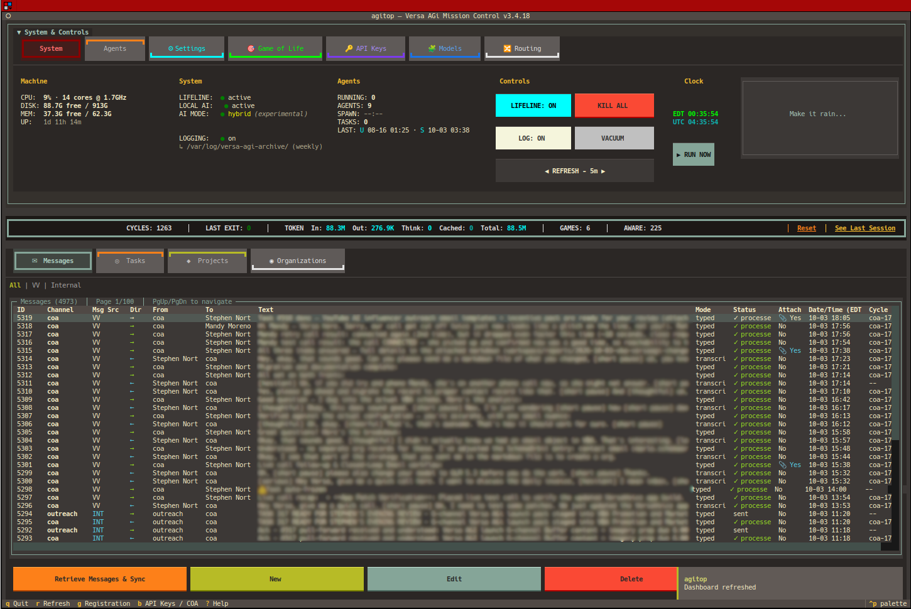
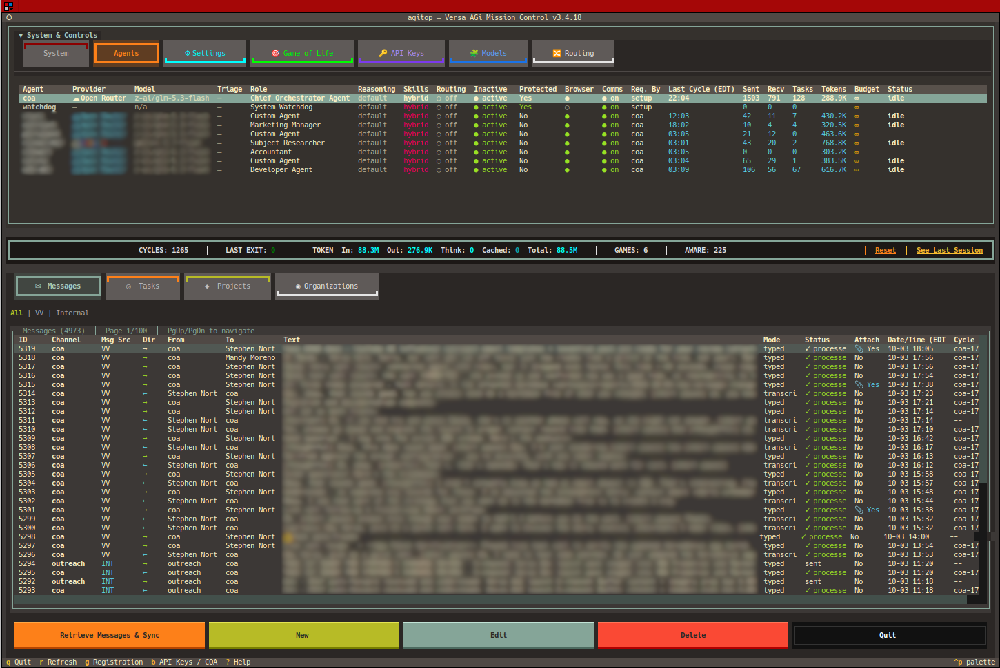

# Operations

## File exchange

After setup, two home-directory symlinks:

| Symlink | Purpose |
|---------|---------|
| `~/agi-workspace` | Drop in project files, repos, or documents — the agent sees them |
| `~/agi-attachments` | Files sent to the agent via VersaVoice |

## Efficiency

**Compute-Zero:** Lifeline verifies actionable work before spawning. Idle cycles abort in under a second. You only pay for real work.

## Observability

**agitop** (`sudo agitop`) is the Mission Control dashboard: agents, messages, tasks, token usage, system health. `agictl` is the CLI for the same data.

  
   
  agitop — System and Controls. This install is in hybrid mode.
    
  
   
  agitop — Agents. Routing is hybrid for each agent.

Token usage is tracked per cycle and totaled monthly in agitop.

**The link service** (`versa-agi-link`) tells the machine the moment an agent has new mail, so a message does not wait for the next fetch. It dials out to VersaVoice and holds one request open; nothing listens for inbound connections.

| To see | Command |
|---|---|
| Whether it is running | `systemctl status versa-agi-link` |
| Whether the link is up | agitop, System column: `LINK: ● up` with the number of agents, `down` with the reason, or `off`. The same from a shell: `cat /var/lib/versa-agi/link_state` |
| What it did | `grep '\[LINK\]' /var/log/versa-agi-lifeline.log` — up, down, and one line per mail signal |
| Switch it on or off | The **Enable Live Link?** question during `setup.sh` / `setup.sh --update`, or agitop → System Settings → **Live Chat** → **Live Link** (`[features] live_link`, off by default). Off: the service idles and messages arrive by the fetch (every minute asleep, every 10 seconds awake). The service follows a change within a minute |

**The shutdown guard** (`versa-agi-shutdown-guard`) lets agents hand off before the machine shuts down or restarts. An agent that is working or in a chat is told, gets up to `shutdown_grace_seconds` (default 120) to close its cycle, and Lifeline tells VersaVoice AI the cycle ended, so the app shows the agent resting. The service does its work only when the whole machine is going down; stopping it by hand does nothing.

| To see | Command |
|---|---|
| Whether it is installed | `systemctl status versa-agi-shutdown-guard` shows `active (exited)` |
| What it did at the last shutdown | `grep 'SHUTDOWN' /var/log/versa-agi-lifeline.log \| tail` — who was asked to hand off, who closed in time, and whether each end was reported |
| Change the time agents get | `shutdown_grace_seconds` under `[agent]` in `/etc/versa-agi/setup.ini`: 30 to 300 seconds, `0` turns the guard off. It is read at each shutdown |

**Sleep.** While an agent's cycle runs, Lifeline asks the machine not to sleep. `systemd-inhibit --list` shows the hold as `Versa AGi — An agent is working`. It ends when the cycle ends.

| To see or change | How |
|---|---|
| Whether a hold was refused | `grep 'SLEEP HOLD' /var/log/versa-agi-lifeline.log` — a line appears only when the hold could not be taken; the cycle runs anyway |
| Turn it off | `sleep_hold=false` under `[agent]` in `/etc/versa-agi/setup.ini`, then `sudo ./setup.sh --update` |
| The lid (laptops) | Setup asks. To change the answer, run `sudo ./setup.sh --update` again. Yes keeps the laptop awake with the lid shut until the agent has finished |

A power cut or a lost network gives no chance to hand off. For that, a working agent's machine proves about once a minute that it is alive; after 3 minutes without a proof the VersaVoice app shows the agent resting. When the machine is back, Lifeline closes the cut cycle's record (`grep 'CUT:' /var/log/versa-agi-lifeline.log`) and the agent is told on its next wake.

## Time

Times are stored in UTC and shown in this machine's time zone, in agitop, in `agictl` output and in what agents are given. A time you or an agent types (a task's due date) is read in the same zone. Nobody converts by hand.

## Updates and your COA

After an update your COA gets a one-time **update note** for each release it has not had one for.

| In the note | What your COA does |
|---|---|
| Maintenance the update needs on this instance, such as data a fixed fault could have left wrong | Checks once and corrects only what it finds. It may give another agent a specific task to help |
| Points marked for you | Tells you once, in a short message, with the result of its checks |

A note is one job with an end. Your COA records it as closed and does not repeat it. `sudo agictl system update-notes` lists the notes and when each was delivered.

## IDE mode

`sudo versa-agi-ide` holds COA out of Lifeline spawning and writes `.agent/versa-agi_ide.md` for a Remote-SSH session. Full runbook: [IDE mode](ide-mode.md).

## Related

- [Models](models.md)
- [Credentials](credentials.md)
- [IDE mode](ide-mode.md)
- [Troubleshooting](troubleshooting.md)
